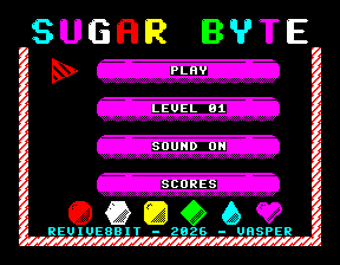
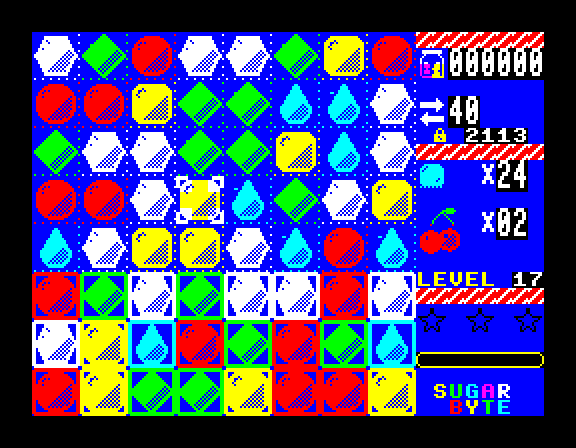
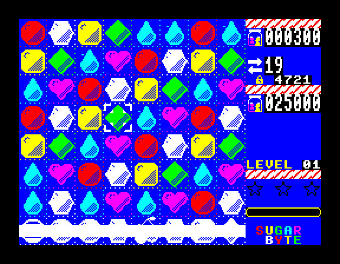
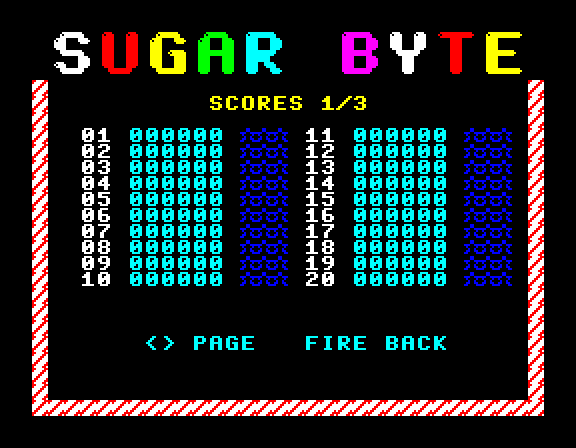

# Sugar Byte — ZX Spectrum

**Sugar Byte** is a match-3 game (in the style of Candy Crush) for the **ZX Spectrum 48K** and **128K**, written in
**Z80 assembly**. It is the Spectrum version of the Amstrad CPC game (`../SugarByteCPC`): the board's logic, the 60
levels, the specials and the codes are the CPC's, carried over unchanged; the picture, the sound, the input and the
tape are new.

| | |
|---|---|
|  |  |
|  |  |

**Player's manual:** [English](docs/manual_en.md) · [Ελληνικά](docs/manual_el.md)

## Features

- An **8×8 board** of 24×24 candies, three character cells each way, filling the screen's height; the HUD in the
  right 64 pixels. Every candy has **its own silhouette** as well as its colour (ball, hexagon, square, diamond,
  teardrop, heart), so the attribute grid never hides what a candy is.
- Everything the CPC version has: **striped** (4 in a row), **wrapped** (L or T), **colour bomb** (5), all six
  combinations of two specials, **jelly**, **icing** (3 layers), **chocolate** that spreads, **licorice**,
  **ingredients** (cherry, nut) to bring down, **holes** in the board with candies sliding diagonally round them,
  chains with a multiplier, a reshuffle when no move is left, a **hint** after 5 seconds, **Sugar Crush** on a win.
- **60 levels** with 1–3 stars, **level codes** to come back to a level, a **best-scores** table.
- **Sound**: on a 128K the CPC's tune and effects on the AY, and the **voice** ("Sugar Byte!", "Sweet!",
  "Delicious!", "Sugar Crush!") as 4-bit samples through the AY's volume registers; on a 48K the same tune and
  effects on the **beeper**, in the time each frame leaves free, and the voice as pulse-width samples.
- **Keyboard** (QAOP, cursor keys), **Sinclair** and **Kempston** joysticks.
- The CPC's raster effects as attribute tricks: the title's letters change colour one by one, the candy-cane
  stripes run.

## Controls

| Action | Keys | Joystick |
|---|---|---|
| Move the cursor | `Q` `A` `O` `P`, cursor keys (`CAPS SHIFT`+`5`–`8`), `5` | Sinclair (`6`–`9`), Kempston |
| Select / swap | `SPACE`, `ENTER`, `0` | fire |
| Music on/off | `M` | |
| Back to the menu / cancel | `BREAK` (`CAPS SHIFT`+`SPACE`) | |

## Requirements

- A ZX Spectrum 48K, 128K or +2 (or an emulator).
- To build:
  - [rasm](https://github.com/EdouardBERGE/rasm) on the `PATH`
  - Python 3 with Pillow and the [`z80`](https://pypi.org/project/z80/) module (the test harness, and the
    loading screen, which is taken from the game's own menu)
  - ffmpeg (the voice)
  - [FBZX](https://gitlab.com/rastersoft/fbzx) for `make run`
  - for `make check`: floooh/chips (`../CPCTools/cpcemu/chips`) and the Spectrum ROMs
    (`/usr/share/spectrum-roms`)
  - to change the art: [Aseprite](https://www.aseprite.org/) (see below)

## Build & run

```bash
make
```

builds `build/sugar.tap` and `build/sugar.tzx` (a BASIC loader, the loading `SCREEN$`, the code) and the snapshots
`build/sugar48.z80` and `build/sugar128.z80`.

```bash
make run
```

```bash
make test
```

runs the scripts in `tests/` (the CPC's, ported) on a headless Spectrum, 48K and 128K: swaps, matches, chains,
specials and their combinations, cells, ingredients, levels, codes, the menu, sound and voice.

```bash
make check
```

loads the tape through the real 48K and 128K ROMs and checks the code landed, took IM 2 and counts its frames.

```bash
make release
```

On a real Spectrum: `LOAD ""` (48K) or Tape Loader (128K).

## The art

All the graphics are drawn in **Aseprite** by the Lua scripts in `tools/aseprite/` — candies, overlays, board
cells, HUD icons, menu tiles, the font and the title. Each script saves its `.aseprite` file in `assets/aseprite/`
and a sheet (`assets/sheets/*.png` + `.json`) that `tools/zxgfx.py` turns into bytes, checking on the way that every
8×8 cell keeps to what the Spectrum can show (one ink per cell for sprites, two colours of one brightness for the
rest). To redraw: open Aseprite and run, for example,

```lua
ROOT = "//wsl.localhost/Ubuntu/home/<you>/repos/SugarByteSpeccy/"   -- or the repository's path
dofile(ROOT .. "tools/aseprite/candy.lua")
```

(or `aseprite -b --script-param ... --script tools/aseprite/candy.lua` with `ROOT` set), then `make`.

## Layout

```
src/            Z80 code (rasm): main.asm includes the rest
tools/          zxgfx.py (art), levels.py, voice.py, mktap.py, mkz80.py, mkloadscr.py,
                zxrun.py (headless Spectrum for the tests), zxcheck.py (the real ROMs)
tools/aseprite/ the Lua scripts that draw the art
assets/         aseprite/ (sources), sheets/ (what the build reads)
levels/         the 60 levels as text
voice/          the four phrases (WAV)
tests/          the scripts of make test
docs/           manuals, screenshots
```

See [planzx.md](planzx.md) (in Greek) for how the port works: memory map, screen layout, drawing, sound.
